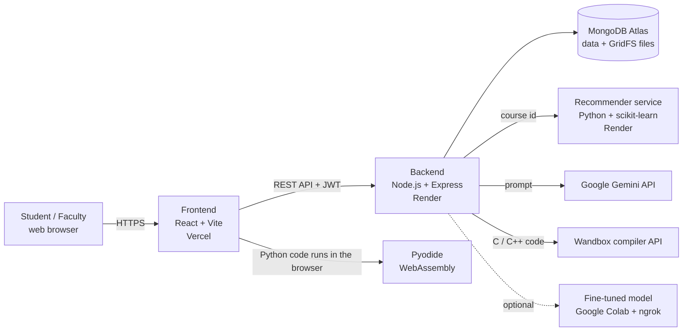

# Study Buddy — A Personal Academic Learning Platform

**Project report**

| | |
|---|---|
| Project type | Full-stack web application (Learning Management System) with machine-learning components |
| Live application | https://study-buddy-tau-ochre.vercel.app |
| Source code | https://github.com/devdavidbuilds/study-buddy (branch `study-buddy-updates`) |
| Stack | React + Vite · Node.js + Express · MongoDB · Python (scikit-learn) · Google Gemini |
| Hosting cost | ₹0 — every service runs on a free tier |

---

## Abstract

Study Buddy is a web-based learning platform for engineering students and the faculty who teach them. Students browse a catalogue of 3,672 courses, request enrollment, study structured lessons, answer lesson checks and module quizzes, submit assignments as PDFs, earn certificates, plan their study time, take notes, practise programming in a built-in Code Lab and ask an AI tutor for help. Faculty approve enrollments, upload lecture materials, create assignments and quizzes, grade submissions, reply to course feedback and follow each student's progress and login activity.

Two machine-learning components support learning: a **course recommender** (TF-IDF + cosine similarity) that suggests related courses, and a **student performance model** (Random Forest regression) that predicts a student's next assessment score. The AI tutor uses Google's Gemini model with a rule-based fallback, and an optional fine-tuned model served from Google Colab.

The whole system is deployed on free tiers (Vercel, Render, MongoDB Atlas) with no paid services and no GPU.

---

## 1. Introduction

### 1.1 Problem

Students typically juggle several disconnected tools: one site for course videos, another for assignments, a separate code editor, a calendar, a notes app and a chatbot. Faculty, in turn, have little visibility into how each student is actually progressing. Generic LMS platforms are often heavy, visually dated and lack hands-on coding practice.

### 1.2 Objectives

1. Bring courses, assessments, assignments, planning, notes, coding practice and AI help into **one calm, consistent workspace**.
2. Give faculty **real control and visibility**: enrollment approval, grading, feedback replies, per-student progress and login status.
3. Make progress **motivating and measurable**: XP, levels, streaks, certificates and charts based on real activity.
4. Add **useful machine learning** that runs without a GPU: course recommendations and performance prediction.
5. Keep the running cost at **zero**.

### 1.3 Scope

- Two user roles with separate experiences: **student** and **faculty** (an **admin** role exists in the data model with faculty-level rights).
- Web application that works on desktop and mobile browsers.
- Light and dark visual themes.

---

## 2. Users and roles

| Role | What they can do |
|---|---|
| **Student** | Sign up and log in; browse and preview courses; request enrollment; learn approved courses; take lesson checks, module quizzes and final assessments; submit PDF assignments; download certificates; plan study sessions and goals; write notes; practise in the Code Lab; chat with the AI tutor; give course feedback; see progress, XP, streaks and achievements. |
| **Faculty** | Log in to a separate dashboard; approve or reject enrollment requests; manage their courses and lecture materials (PDF/PPT); create assignments and quizzes; evaluate submissions (marks + feedback, or return for resubmission); reply to course feedback; view every student's details, login status and per-course progress; see recent student activity. |
| **Admin** | Same rights as faculty across all courses (used for maintenance). |

Access rules are enforced on the **server**, not only hidden in the interface. For example, a student without an approved enrollment receives `403 ENROLLMENT_REQUIRED` when trying to complete a lesson, submit a quiz or download course materials.

---

## 3. Features

### 3.1 Student features

| Area | Description |
|---|---|
| **Landing, sign-up, login** | Public landing page. Two-step sign-up collecting phone, date of birth, university, department, year of study and roll number. JWT-based login. |
| **Home (Workspace)** | Greeting with level and XP, "Continue learning" cards with progress, today's schedule, recent notes, upcoming assignments, weekly study-hours chart, course progress rings, quick actions, quiz practice chart and learning goals — all from real data. |
| **Course marketplace** | 3,672 courses with search, category and level filters, sorting, wishlist, and the student's own courses pinned at the top. |
| **Course page** | Overview, curriculum, lecture materials, reading list, feedback and discussion tabs. Students without approval see a **preview** (lesson content hidden) and a "Request enrollment" button. |
| **Enrollment approval** | Request → faculty approves or rejects (with an optional note) → full access. States shown as "Awaiting approval" and "Request again". |
| **Learning view** | Structured lessons with learning objectives, reading material, key concepts, worked examples and a short **lesson check** scored on the server. Each module ends with a **module quiz**, and each course with a **final assessment**. |
| **Certificates** | Issued automatically at 100% completion as a generated PDF with a unique ID (e.g. `SB-2026-…`) and a public verification endpoint. |
| **Assignments** | Students upload one PDF per assignment (signature-checked, size-limited). Statuses: *Submitted → Evaluated*, or *Returned* for resubmission with feedback. |
| **Study Planner** | Weekly calendar of study sessions per course, weekly goals, time allocation per course and today's schedule. |
| **Notes** | Personal notes stored per student. |
| **Progress & Achievements** | Day streak, total XP, level, hours this week, weekly and monthly charts, leaderboard, badges and certificate list. |
| **AI Tutor** | Chat assistant for any subject or programming question (details in §6.3). |
| **Code Lab** | In-browser IDE with coding problems, sample programs and an **interactive terminal** (details in §6.4). |
| **Reading list & feedback** | Each course has a curated reading list (books, papers, documentation). Enrolled students rate the course, write feedback and mark others' feedback as helpful. |
| **Related courses** | ML-based recommendations on every course page (§7.1). |
| **Notifications** | Bell menu and Notifications page built only from real events: enrollment decisions, graded or returned assignments, faculty replies to feedback, new lecture materials and assignments, deadlines within 3 days and new certificates. Refreshes every minute and when the tab regains focus. |
| **Themes** | "Sakura Day" (light) and "Sakura Midnight" (dark), or follow the device setting (§6.6). |

### 3.2 Faculty features

| Area | Description |
|---|---|
| **Dashboard** | Totals (courses, students, active assignments, average progress), recent student activity and quick actions. |
| **My Courses** | Course list with module and lesson counts; edit course content. |
| **Lecture Materials** | Upload PDF, PPT and PPTX files per course (validated by extension, MIME type and file signature). |
| **Assignments** | Create assignments with deadlines and maximum marks. |
| **Submissions & Evaluation** | Open each PDF, give marks and feedback, or return it to the student. Evaluated submissions are locked to protect grades. |
| **Quiz Creator** | Create multiple-choice quizzes for a course or lesson. |
| **Enrollment Requests** | Approve or reject pending requests, with a badge showing how many are waiting. |
| **Course Feedback** | Read ratings and comments and reply, with an unreplied-count badge. |
| **Students** | Every student with their profile details, last login, login count and an "online" indicator (seen in the last 5 minutes). |
| **Student Progress** | Per-course, per-student completion, quiz and lesson-check results. |

---

## 4. System architecture



Plain-text version:

```
Browser ──► React frontend (Vercel)
               │  REST + JWT
               ▼
         Express backend (Render) ──► MongoDB Atlas (documents + PDF/PPT files in GridFS)
               ├──► Python recommender (Render)
               ├──► Google Gemini (AI tutor)
               ├──► Wandbox (C / C++ compilation)
               └──► Fine-tuned model on Colab (optional)

Python in the Code Lab runs inside the browser (Pyodide), not on the server.
```

**Design choices**

- **Three-tier separation.** The interface, API and database are deployed separately and talk only through the REST API.
- **Machine learning as a separate service.** The recommender runs as its own Python service. If it is down, only the "Related courses" card disappears; the rest of the site keeps working.
- **Files in the database (GridFS).** Render's free disk is wiped on every deploy, so assignment PDFs and lecture materials are stored in MongoDB GridFS.
- **Python runs in the browser.** Running student Python with Pyodide (WebAssembly) costs no server resources and supports libraries such as NumPy, pandas, scikit-learn and matplotlib.

---

## 5. Technology stack

| Layer | Technology | Purpose |
|---|---|---|
| Frontend | **React 19**, **Vite**, React Router | Single-page application and routing |
| UI | Framer Motion, Lucide icons, Recharts, custom CSS design system | Animations, icons, charts, light/dark themes |
| Code editor | Monaco Editor (the editor behind VS Code) | Code Lab editor |
| In-browser Python | **Pyodide 0.26** (CPython compiled to WebAssembly) in a Web Worker | Runs student Python safely in the browser |
| Backend | **Node.js 20+**, **Express** | REST API |
| Database | **MongoDB** (Atlas) with **Mongoose**; **GridFS** for files | Data and file storage |
| Authentication | JSON Web Tokens (7-day expiry), **bcrypt** password hashing | Login and role checks |
| Files | Multer (uploads), pdfkit (certificate PDFs), pdf-parse | Assignments, materials, certificates |
| AI | Google **Gemini** via `@google/genai`; pluggable LLM layer (Gemini / OpenAI-compatible / mock) | AI tutor and content generation |
| Compilers | Wandbox API (Judge0 supported when a key is configured) | C and C++ execution |
| Machine learning | **Python 3.11**, **scikit-learn 1.7** | Recommender (TF-IDF) and performance model (Random Forest) |
| Hosting | **Vercel** (frontend), **Render** (backend + recommender), **MongoDB Atlas M0** | Free-tier deployment |
| Version control | Git + GitHub | Source history and automatic deploys |

---

## 6. Module descriptions

### 6.1 Authentication and access control

- Passwords are hashed with bcrypt (salt rounds 10) before saving; plain passwords are never stored.
- Login returns a JWT containing the user id and role. Every protected route checks the token and the role (`student`, `faculty` or `admin`).
- Each login updates `lastLoginAt` and `loginCount`, and activity refreshes `lastSeenAt` at most once a minute. This powers the faculty "Students" page and its online indicator.
- Course content is gated by **enrollment status**: preview for everyone, full lessons only for approved students and the course's faculty.

### 6.2 Courses, content and progress

- **Catalogue.** 3,672 courses imported from a public dataset across four categories: Web Development, Business Finance, Musical Instruments and Graphic Design. Catalogue cleanup tools (`auditCatalog.js`, `cleanupCatalog.js`) detect duplicates and broken titles, with a restore option.
- **Structured content.** Each course is organised as modules → lessons. A lesson contains learning objectives, reading material, key concepts, examples and a lesson check. Eight showcase courses have hand-written, course-specific lessons; every other course uses a hand-written curriculum for its category.
- **Progress.** `CourseProgress` stores completed lessons, lesson-check results, quiz attempts and assignment submissions per student per course. Answers are **scored on the server**, so students cannot fake results.
- **XP and levels.** 50 XP per lesson, 20 XP per lesson check passed at 60%+, 30 XP per quiz passed, 200 XP per certificate; 1,000 XP per level.
- **Streaks.** A streak counts consecutive days with learning activity, using the student's own time zone.

### 6.3 AI Tutor

- **Primary engine:** Google Gemini through a provider-independent LLM layer (`services/llm`), with retries, rate limiting and a 30-second timeout. The tutor uses the fast "flash-lite" model, which answers in about 1.5–5 seconds; the full Flash model was measured at 30–40 seconds.
- **Fallback:** if Gemini is unavailable, out of quota or not configured, a rule-based engine answers instead, and the reply says why (`notice`: quota, timeout, not configured, …).
- **Fine-tuned model (optional):** a model fine-tuned with LoRA in Google Colab (`ml/study_buddy_colab.ipynb`), exposed through an ngrok tunnel and proxied by the backend at `/api/ai-chat`. Students switch between "AI Tutor" and "Fine-tuned model" in the chat. It only works while the Colab notebook is running.
- Answers are rendered as formatted Markdown, including code blocks.

### 6.4 Code Lab

An in-browser programming environment with:

- **Problems** (Two Sum, Valid Parentheses, Binary Search, Climbing Stairs and others) with visible test cases, hidden test cases, hints and an editorial. **Submit** checks the hidden cases and returns a verdict (Accepted, Wrong Answer, Runtime Error, Time Limit Exceeded).
- **Sample programs** in Python, C and C++, including data science and machine learning demos (NumPy, pandas, scikit-learn, matplotlib plots, SymPy).
- **Monaco editor** with tabs, font zoom, upload/download, reset and submission history.
- **Interactive terminal.** Output appears as the program prints it, and when a Python program calls `input()` it pauses until the student types a value and presses Enter. Ctrl+D ends input and Ctrl+C or Stop ends the program.
  - *How it works:* Python runs in a Web Worker (Pyodide). When the program reads input, the worker makes a blocking request that a small service worker (`codelab-stdin-sw.js`) holds open until the student presses Enter. Time spent waiting for input does not count towards the 20-second limit.
  - *C and C++* are compiled by the Wandbox service in a single request, so the terminal collects all input first and then runs the program.
- **Rate-limit design.** Wandbox allows about 5 requests per short window, shared by all students, so all test cases of a submission are combined into **one** request.

### 6.5 Assignments, materials, certificates, planner, notes and feedback

| Module | Key points |
|---|---|
| Assignment PDFs | One PDF per submission, checked for a real `%PDF-` signature, 10 MB default limit, stored in GridFS. Only the student, the course's faculty and admins can open it; anyone else gets 404. |
| Lecture materials | PDF/PPT/PPTX up to 25 MB, validated by file content. PDFs open in the browser; slides download. |
| Certificates | Generated with pdfkit when a course reaches 100%. Each has a unique ID and can be verified at `/api/certificates/verify/:id`. |
| Planner | `StudySession` and `StudyGoal` collections; weekly view, per-course time allocation. |
| Notes | `Note` collection, private to each student. |
| Reading list | Books, papers and documentation per course (`Course.references`), each marked as free or library access. |
| Course feedback | One rating and comment per student per course; only approved students can post; others can mark it helpful; faculty reply. |

### 6.6 User interface and themes

- A consistent **"Sakura"** design system (pink and lavender palette, glass cards, falling-petal animation) applied across all pages, with responsive layouts and a bottom navigation bar on phones.
- **Sakura Midnight** dark theme: deep violet night sky with slowly moving aurora glows and twinkling stars, glowing petals, frosted cards with neon-pink edges and gradient titles.
- **Theme switch:** a sun-and-moon toggle in the top bar, plus Light / Dark / Match system options in Settings. The new theme spreads out in a circle from the click point (View Transitions API). The choice is saved in the browser and applied before the page loads, so there is no white flash.
- **Accessibility:** animations are reduced when the operating system asks for reduced motion, and the switches use proper `switch`/`radio` roles.

---

## 7. Machine-learning components

### 7.1 Course recommender (deployed)

**Goal.** On every course page, suggest the five most related courses from the 3,672-course catalogue.

**Method.** Content-based filtering with **TF-IDF** and **cosine similarity** (scikit-learn).

1. Each course's title, category, description and tags become one text document. The text is lower-cased, URLs are removed, and terms such as "C++", "C#" and ".NET" are kept intact.
2. A `TfidfVectorizer` (single words and two-word phrases, English stop words removed) produces a sparse matrix of 3,672 courses × about 15,700 terms. Terms that appear in more than half of all courses are dropped (`max_df = 0.5`); this removes template text automatically.
3. Each term weight is

   tfidf(t, d) = (1 + ln tf(t, d)) × (ln((1 + N) / (1 + df(t))) + 1)

   so rare, specific words ("django", "ukulele", "photoshop") count most.
4. For a selected course, similarity to every other course is

   cos(q, d) = (q · d) / (|q| |d|)

   The top five are returned, excluding the course itself and duplicate titles, along with the terms that matched, so each suggestion can be explained.

**Why no GPU is needed.** Fitting is a single pass over about 2.6 MB of text (around 1 second on a CPU), and each query is one sparse matrix–vector product.

**Deployment.** `ml/service.py` (Python standard-library HTTP server) runs on Render. The Node backend calls it with a shared token and fetches the matching courses from MongoDB. Free Render services go to sleep, so the backend pings the recommender every 10 minutes to keep it awake. The recommender has 22 automated tests (`ml/test_recommender.py`).

### 7.2 Student performance model (built and evaluated, not shown to students)

**Goal.** Predict a student's score on their next assessment so faculty could identify students who need help early.

**Features** (computed only from events *before* the predicted attempt, so the model cannot see the answer): previous quiz average, number of previous attempts, course completion percentage, and last quiz score.

**Model.** Random Forest regression (scikit-learn), split **by student** so the same student never appears in both training and test data.

**Results**

| Data | Model MAE | Baseline MAE | R² |
|---|---|---|---|
| Synthetic data (to validate the pipeline) | 6.47 | 11.83 / 8.43 | 0.70 |
| Demo-student data (130 quiz attempts, 466 lesson checks) | 16.7 | 17.0 / 18.6 | −0.16 |

**Interpretation.** On the real demo data the model is only slightly better than simple baselines. A three-question lesson check is a noisy signal, and the data set is small. For that reason the model is **not integrated** into the student interface, and the training script refuses to train on real data with fewer than 50 rows or 10 students. This is reported openly as a limitation (§11).

### 7.3 Language models

- **Gemini** (Google) powers the AI tutor and the optional course-content generation pipeline (`Backend/docs/COURSE_CONTENT.md`).
- A **LoRA fine-tuned model** can be served from Google Colab's free GPU and used through `/api/ai-chat`.
- The LLM layer is provider-independent (Gemini, any OpenAI-compatible API, or a mock for tests), so the model can be changed through configuration alone.

---

## 8. Database design

MongoDB database `studybuddy` (Atlas). Main collections:

| Collection | Purpose | Key fields |
|---|---|---|
| `users` | Students, faculty, admins | fullName, email (unique), password (bcrypt hash), role, phone, dateOfBirth, university, department, yearOfStudy, rollNumber, bio, preferences, lastLoginAt, lastSeenAt, loginCount |
| `courses` | Catalogue and content | courseName, category, level, description, instructor, faculty, modules → lessons, references (reading list), rating, students |
| `enrollments` | Access control | student, course, status (pending / approved / rejected), message, decisionNote, source |
| `courseprogresses` | Learning record per student per course | completedLessons, lessonChecks, quizAttempts, assignments (with file and evaluation) |
| `quizzes` | Module quizzes and faculty quizzes | course, module, questions, options, marks |
| `assignments` | Faculty-created assignments | course, title, deadline, maxMarks |
| `certificates` | Completion certificates | certificateId, student, course, issuedAt |
| `studysessions`, `studygoals` | Planner | course, date, duration, goal targets |
| `notes` | Student notes | owner, title, content |
| `coursefeedbacks` | Ratings and comments | course, student, rating, comment, helpful, reply |
| `lecturematerials` | Material metadata | course, title, type, GridFS file id |
| `studentactivities` | Activity feed for faculty | student, course, action, timestamp |
| `submissions` | Code Lab submission history | problem, language, verdict, code |
| GridFS buckets `submissionFiles`, `lectureMaterials` | Binary files | PDF / PPT content in chunks |

Indexes on course `createdAt`, `rating` and `students` keep catalogue sorting fast. List endpoints return only summary fields, never full lesson trees, which keeps responses small even though one faculty account owns all 3,672 courses.

---

## 9. API overview

All endpoints are under `/api`. Every route except login, sign-up, the public course list and certificate verification requires a JWT.

| Prefix | Main operations |
|---|---|
| `/auth` | register, login, profile (get / update) |
| `/courses` | list with filters and paging, course detail (full or preview), create / update (faculty) |
| `/enrollments` | request, my enrollments, enrollment status for a course, pending requests and decisions (faculty) |
| `/progress` | complete lesson, lesson check, quiz submit, assignment PDF submit, my submissions, summary (XP, level, streak) |
| `/quizzes`, `/assignments` | create and list (faculty), take and submit (student) |
| `/submissions` | secure PDF download |
| `/materials` | upload, list, open lecture materials |
| `/certificates` | my certificates, PDF download, public verification |
| `/planner` | study sessions and goals |
| `/notes` | create, read, update, delete notes |
| `/feedback` | course feedback, helpful votes, faculty inbox and replies |
| `/faculty/courses`, `/faculty/students` | dashboard overview, per-course progress, student list and details |
| `/chatbot`, `/ai-chat` | AI tutor (Gemini with fallback) and the fine-tuned model |
| `/compiler` | run and submit code (C / C++ on the server) |
| `/recommendations` | related courses (calls the ML service), read-only catalogue export for training |
| `/activity` | recent student activity |
| `/notifications` | the student's notifications, built from real records of the last 30 days |

---

## 10. Deployment

| Component | Platform | Notes |
|---|---|---|
| Frontend | Vercel (free) | Automatic deploy on every push to `study-buddy-updates`; SPA rewrite in `vercel.json` |
| Backend API | Render web service (free) | Node 20; environment variables hold the database URI, JWT secret, Gemini key and recommender token |
| Recommender | Render web service (free) | `python -u service.py --retrain`; kept awake by a backend ping every 10 minutes |
| Database + files | MongoDB Atlas M0 (512 MB free) | About 310 MB used, including 41.6 MB of lecture-note PDFs |
| AI | Gemini API free tier | The tutor uses a model with a separate daily quota from content generation |

**Workflow.** Code is developed locally against a local MongoDB, committed with Git and pushed to GitHub, which triggers the Vercel and Render deploys within about a minute. Database changes go through scripts with a dry-run mode, a backup first (`backup-atlas-db.js`), and insert-only or reversible operations.

---

## 11. Testing and verification

- **API smoke tests** of every route as a student and as faculty, against both the local and the live deployment.
- **Browser tests:** a headless Microsoft Edge driven through the Chrome DevTools Protocol logs in, opens every page and checks for console errors, failed API calls and layout overflow. The same scripts typed into the Code Lab terminal to verify interactive input, runtime errors, Stop and test-case runs.
- **Theme audit:** an automated scan of every student page, every course-page tab and all 12 faculty dashboard tabs in dark mode, flagging any remaining light surfaces or unreadable text.
- **Recommender:** 22 unit tests. **Performance model:** a test suite plus checks that features use only earlier events.
- **End-to-end checks** for enrollment approval (20 of 20 checks passed on production), PDF submissions (23 API tests and 18 interface tests) and certificates.

---

## 12. Demo data

For demonstration, the database was seeded (`Backend/scripts/seedDemoData.js`) with:

- Structured lessons for all 3,672 courses, 11,016 module quizzes and 3,672 lecture-note PDFs.
- 15 demo student accounts (`@demo.studybuddy.in`) with a realistic learning history: 466 lesson checks, 130 quiz attempts, 22 certificates, 70 approved enrollments and 2 pending requests.
- 61 demo course-feedback entries, deliberately left unreplied so faculty can reply during a live demo.

Demo passwords are kept outside the repository.

---

## 13. Limitations and future work

| Limitation | Possible improvement |
|---|---|
| The performance model is only slightly better than baselines on real data | Collect more real quiz attempts; add richer features (time on task, topic difficulty); then show predictions to faculty only |
| The Gemini free tier allows about 20 requests per day per model | Paid tier, or a self-hosted open model |
| C/C++ programs cannot pause for input mid-run | A self-hosted Judge0 or WebAssembly C compiler would allow fully interactive C/C++ |
| The fine-tuned model only works while Colab is running | Host it on an always-on inference service |
| Free Render services sleep when idle (handled with keep-warm pings) | A paid always-on instance |
| Atlas free tier is 512 MB | Move files to object storage (e.g. S3 or Cloudflare R2) as uploads grow |
| The recommender is content-based only | Add collaborative filtering once enough enrollment history exists |
| No real-time chat or notifications | WebSocket notifications for approvals, grades and feedback replies |

---

## 14. Conclusion

Study Buddy shows that a complete, modern learning platform can be built and run at zero cost. It covers the full cycle: discovering a course, getting approved, learning structured content, practising code with a real interactive terminal, being assessed and graded, earning a certificate and giving feedback. Faculty get real oversight through approvals, grading, feedback replies and per-student progress.

The machine-learning parts are deliberately practical and honest. The TF-IDF recommender is fast, explainable and live in production. The performance model was built with a leakage-free design and evaluated openly; it is held back from students until enough real data exists.

---

## Appendix A — Running the project locally

```bash
# 1. Backend (needs Node 20+ and MongoDB)
cd Backend
npm install
# create .env with MONGODB_URI, JWT_SECRET and optionally GEMINI_API_KEY
npm run dev                 # http://localhost:5000

# 2. Frontend
cd Frontend
npm install
npm run dev                 # http://localhost:5173

# 3. Recommender (optional, for "Related courses")
cd ml
pip install -r requirements.txt
python -u service.py        # http://127.0.0.1:8001
```

## Appendix B — Repository structure

```
progress/
├── Backend/            Express API
│   ├── controllers/    request handlers (auth, courses, progress, enrollments, feedback, …)
│   ├── models/         Mongoose schemas (User, Course, CourseProgress, Enrollment, …)
│   ├── routes/         URL → controller mapping
│   ├── services/       LLM layer, course-content pipeline, Wandbox / Judge0, chatbot
│   ├── middleware/     JWT auth, role checks, PDF upload validation
│   ├── utils/          certificates, enrollment rules, GridFS file helpers
│   └── scripts/        seeding, catalogue audit and cleanup, migrations
├── Frontend/           React application
│   ├── src/pages/      Workspace, Courses, CodeLab, Planner, Faculty, Settings, …
│   ├── src/components/ UI kit, layout, Code Lab editor and terminal, course widgets
│   ├── src/context/    theme state
│   ├── src/styles/     design system, layout, pages, dark theme
│   ├── src/workers/    Pyodide worker for in-browser Python
│   └── public/         static files, Code Lab input service worker
└── ml/                 Python machine learning
    ├── recommender.py, service.py, train_model.py, test_recommender.py
    ├── performance/    performance-prediction model
    └── study_buddy_colab.ipynb   fine-tuned model server
```
