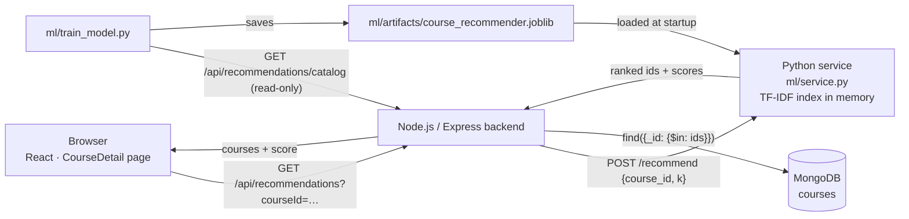

# Study Buddy — Course Recommendation Model

A content-based recommender that suggests courses for a **search query**, a
student's **interests**, or a **selected course** ("similar courses"). It uses
**TF-IDF** text features and **cosine similarity** from scikit-learn, runs on a
laptop CPU in milliseconds, and needs no GPU, no pretrained model and no
external AI API.

> This folder also contains `study_buddy_colab.ipynb` (the separate fine-tuned
> AI-tutor notebook). It is unrelated to the recommender.
> The folder is named `ml` (lower case). Windows does not care, but Linux
> hosts such as Render do — use `ml` in deployment paths.

---

## 1. Problem statement

The catalog has 3,672 courses. Students searching or browsing need the few
courses that are actually relevant to what they typed or what they are
looking at. Before this model, the "Related Courses" card on a course page
just showed the newest three courses in the catalog, whatever their topic.

## 2. Dataset

The model is trained on the **real Study Buddy catalog** in MongoDB, read
through the backend's read-only export endpoint
`GET /api/recommendations/catalog`. No fake courses are generated, nothing is
written to the database, and the Python code never sees database credentials.

Fields used per course (from `Backend/models/Course.js`):

| Field | Used? | Note |
|---|---|---|
| `courseName` | yes, weight ×2 | the most descriptive field |
| `category` | yes | 4 values in the current catalog |
| `description` | yes | the `Course URL: https://…` part is removed |
| `skills`, `outcomes` | yes | mostly template text, which TF-IDF weighs down to ~0 |
| `modules[].title`, `modules[].summary`, `contentMeta.summary` | yes | useful for faculty-written courses |
| lesson titles | no | generated from the category in the imported catalog ("Web Development Fundamentals 1 — Beginner") — no signal, ~90% of the export size |

What profiling the real catalog showed (2026-10-21):

- 3,672 courses in **4 categories**: Web Development 1,199, Business Finance
  1,191, Musical Instruments 680, Graphic Design 602.
- `skills`, `outcomes` and module/lesson titles are template text; the real
  signal is the **title + category**.
- 14 duplicate titles (e.g. "Acoustic Blues Guitar Lessons" ×3) — each is
  shown at most once in a result list.
- **No course is about machine learning** — the word "machine" does not occur
  anywhere in the catalog (see Limitations).

## 3. How the model works

```
course fields ──► one text document per course
                    │  lower-case, drop URLs, keep "C++", "C#", ".NET", "Node.js" as terms
                    ▼
               TfidfVectorizer  (fit once on all courses)
                    │  words + two-word phrases, stop words removed
                    ▼
               sparse matrix  3,672 courses × ~15,700 terms  (sparse, ~1 MB)

query text  ──► same vectorizer.transform  ──► 1 × 14,600 vector
                                                   │
                         cosine_similarity(query, every course)  →  3,672 scores
                                                   ▼
                drop excluded / duplicate courses, sort, return top 5 (id, title, score)
```

**TF-IDF (term frequency × inverse document frequency).** Each term `t` in
course `d` gets the weight

    tfidf(t, d) = (1 + ln tf(t, d)) × (ln((1 + N) / (1 + df(t))) + 1)

where `tf` is how often the term occurs in that course, `N` the number of
courses and `df` how many courses contain it. Rare, specific terms
("django", "ukulele", "photoshop") get high weights; terms almost every
course shares get low weights. Terms in more than 50% of courses are dropped
(`max_df=0.5`); that removes the template text automatically. A short list of
course-format words ("beginners", "complete", "tutorial", …) is also
ignored, so "Django For Beginners" matches Django courses rather than
"CSS For Beginners". Each course vector is scaled to length 1.

**Cosine similarity.** The score between a query vector `q` and a course
vector `d` is

    cos(q, d) = (q · d) / (|q| |d|)

1.0 means the same weighted terms, 0 means no shared terms. Because all
vectors have length 1, this is a single sparse dot product per course.

**Ranking.** Courses with score > 0 are sorted by score (ties keep catalog
order, so results are repeatable). The selected course, extra listings of
the same title, and any `exclude_ids` are removed, and the top *k*
(default 5, max 50) are returned with the terms that contributed most
(`matched_terms`) — so every recommendation can be explained.

**What it is not.** This is a classic information-retrieval model, not a
neural network or a language model. "Training" means counting terms and
computing IDF weights over the catalog; there are no learned weights, no
embeddings and no gradient descent.

**Why no GPU is needed.** Fitting is one pass over ~2.6 MB of text (~1 s on
CPU). Each query is a sparse 1 × 15,700 by 15,700 × 3,672 multiplication — microseconds of arithmetic. The full 3,672 ×
3,672 course-to-course matrix (13.5 M floats) is never built; each query
computes only its own row of scores.

Edge cases handled: empty catalog, records without an id or with a duplicate
id, missing/`null` fields, courses with no usable text, empty / non-string /
stop-word-only queries, and queries with no known words (they return an
empty list, never random filler).

## 4. Architecture



Plain-text version:

```
Browser ──► Node backend ──► Python recommender ──► ranked course ids
               │   ▲                    ▲
               ▼   │ canonical course   │ trained index (artifacts/*.joblib)
            MongoDB  data + score       │
               ▲                        │
               └── read-only catalog ◄── train_model.py
```

- The **Python service** only knows ids, titles and term weights. It holds no
  database connection and no secrets (except an optional shared token).
- The **Node backend** stays the source of truth: it validates the request,
  calls the service with an 8 s timeout, then loads the courses from MongoDB.
  Courses deleted or archived since training are dropped.
- If the service is down, `GET /api/recommendations` returns **503** with a
  clear message; the course page hides its Related Courses card. Nothing else
  in the app depends on the service.

### Files

| File | Purpose |
|---|---|
| `recommender.py` | `CourseRecommender` (fit, `recommend`, `similar_to`, save/load) + CLI demo |
| `train_model.py` | downloads the catalog, fits the model, prints stats, saves `artifacts/course_recommender.joblib` |
| `service.py` | HTTP API (Python standard library, no Flask) used by the backend |
| `test_recommender.py` | unit tests + printed demo results |
| `requirements.txt` | `scikit-learn==1.7.1` (brings NumPy, SciPy, joblib) |
| `Backend/controllers/recommendationController.js` | `GET /api/recommendations`, `GET /api/recommendations/catalog` |
| `Frontend/src/api/recommendationApi.js` | axios helper |

## 5. Setup (Windows)

```bat
cd D:\progress
python -m pip install -r ml\requirements.txt
```

Train (needs the backend running locally, `cd Backend && npm run dev`):

```bat
python ml\train_model.py
```

Re-run training whenever courses are added or edited. Training from a saved
export also works: `python ml\train_model.py --input catalog.json`.

## 6. Demo commands

These use the saved model, so they work **even with the backend and database
offline**:

```bat
python ml\recommender.py "Python programming"
python ml\recommender.py "machine learning"
python ml\recommender.py "data analytics"
python ml\recommender.py "guitar chords" -k 3
python ml\test_recommender.py
```

Expected output for `Python programming` (trained 2026-10-21, after the
course content update; scores change whenever the catalog text changes):

```
   #   Score  Category             Title
   1   0.506  Web Development      Introduction to QGIS Python Programming
   2   0.384  Web Development      Python Programming: Create an Digital Marketplace in Django
   3   0.304  Web Development      Python Web Programming
   4   0.293  Web Development      Web Programming with Python
   5   0.184  Web Development      Python for Beginners: Python Programming Language | Tutorial
```

Full app (three terminals):

```bat
cd D:\progress\Backend && npm run dev
cd D:\progress && python ml\service.py
cd D:\progress\Frontend && npm run dev
```

Open any course page; the **Related Courses** card lists the five most
similar courses with a "% match" (= cosine similarity × 100). API checks:

```bat
curl "http://localhost:5000/api/recommendations?q=Python%20programming"
curl "http://localhost:5000/api/recommendations?courseId=<a course _id>&limit=5"
curl "http://127.0.0.1:8001/recommend?q=machine%20learning"
```

`GET /api/recommendations` parameters: `q` (≤ 200 chars) and/or `courseId`
(a valid ObjectId), `limit` 1–10 (default 5). Response:
`{ success, count, data: [course fields + score], query, courseId, model }`.

## 7. Testing performed

`python ml\test_recommender.py` — 22 tests:

- **Edge cases** (hand-written fixture): bad/duplicate/id-less records
  skipped; ranking order and score range; empty, whitespace, non-string and
  stop-word-only queries return `[]`; unknown words return `[]`; courses with
  no description are still found; `C++`/`Node.js`-style names; the selected
  course and its duplicate listings are excluded; fallback text for courses
  added after training; `k` validation; empty / unusable datasets; save →
  load round trip.
- **Service validation**: query and course requests, and 400s for missing,
  wrong-type, over-long and malformed input.
- **Real catalog** (skipped if no trained model): ≥ 1,000 courses; all top-5
  for "Python programming" have "python" in the title; all top-5 for "web
  development" are Web Development courses; "data analytics" ranks an
  analytics course first; "machine learning" reports "machine" as unknown;
  similar courses for a Django course exclude it and its duplicates.

Run 2026-10-21: 22 passed. Backend checks run the same day: the
recommendation endpoint end to end, input validation, 503 when the service
is stopped, existing routes unchanged, frontend production build OK.

## 8. Limitations

- **Word matching, not meaning.** TF-IDF matches terms, not concepts.
  "machine learning" only matches the word "learning" ("Learning Drupal 8")
  because no course in this catalog is about machine learning; `"ML"` or
  `"AI"` would not match "artificial intelligence" either. The CLI and API
  report the words the model does not know, so this is visible rather than
  hidden.
- **The catalog text is thin.** Most courses have only a title and one of 4
  categories as real information, so courses with very short titles can tie
  (e.g. several Web Development courses tying for "web development").
- **No personalisation yet.** It does not use enrolments, progress or ratings.
- **Snapshot.** New or edited courses are only reflected after retraining
  (new courses can still get "similar courses" from their text).
- **Spelling.** Misspelled queries ("pyhton") do not match.
- `joblib` model files are pickles — only load files you trained yourself.

## 9. Possible improvements

- Richer course text (real descriptions, generated lesson content) would
  improve results more than any model change.
- Collaborative filtering from `CourseProgress` (students who took X also
  took Y), blended with this content score.
- Character n-grams for typo tolerance; synonyms (ML → machine learning).
- Small CPU sentence-embedding models (e.g. MiniLM, ~90 MB) for meaning-based
  matching, if the extra size is acceptable.
- Filter or boost by level and by courses the student has already completed.

## 10. Deployment (not done — manual steps)

The recommender is **not deployed**. Production keeps working without it:
the Related Courses card is simply hidden until the service is configured.
The Python service is a **separate Render web service**, independent of the
existing Node.js service.

1. Push the backend change first (it adds `/api/recommendations/catalog`,
   which the Python service trains from).
2. Render → New → Web Service → same repository, branch `study-buddy-updates`:

   | Setting | Value |
   |---|---|
   | Root Directory | `ml` |
   | Runtime | Python 3 |
   | Build Command | `pip install -r requirements.txt` |
   | Start Command | `python -u service.py --retrain` |
   | Instance type | Free |

   Environment variables:

   | Key | Value |
   |---|---|
   | `PYTHON_VERSION` | `3.11.9` |
   | `RECOMMENDER_HOST` | `0.0.0.0` |
   | `RECOMMENDER_CATALOG_URL` | `https://study-buddy-91gv.onrender.com/api/recommendations/catalog` |
   | `RECOMMENDER_API_TOKEN` | a long random string |

   Render sets `PORT`. `--retrain` builds the model from the live catalog at
   every start (~2.6 MB download + ~1 s fit), because Render's disk is
   temporary; memory use is well under the free tier's 512 MB.
3. On the **existing Node.js service**, add:

   | Key | Value |
   |---|---|
   | `RECOMMENDER_URL` | the new service's URL, e.g. `https://study-buddy-recommender.onrender.com` |
   | `RECOMMENDER_API_TOKEN` | the same random string |

4. Check: `https://<recommender>.onrender.com/health`, then
   `https://study-buddy-91gv.onrender.com/api/recommendations?q=python`.

Free-tier services sleep after ~15 minutes idle. The first request after
that can take about a minute while both services wake up; the backend's 8 s
timeout returns 504 for that request and the card stays hidden, and later
requests are fast.
